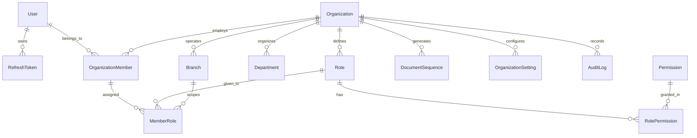

# Core ERP Database Architecture Specification

- **Status**: Validated Design
- **Date**: 2026-11-08
- **Scope**: Generic Multi-Tenant Enterprise ERP Core Platform (Foundational Schema)

---

## 1. Executive Summary

This specification establishes the architectural foundation for Novex ERP backend. The database architecture is designed to be completely domain-agnostic at its core, enabling any future business module (Sales, Procurement, Inventory, Manufacturing/Production, HR, Accounting) to plug in seamlessly without architectural refactoring.

The core platform provides:
1. **Multi-Tenancy**: Organization-based tenant isolation.
2. **Enterprise Organization Hierarchy**: Multi-branch, multi-warehouse/facility, and departmental structure.
3. **Fine-Grained Dynamic RBAC**: Custom roles, granular permission matrices, and organization-scoped member roles.
4. **Auditability & Compliance**: Immutable audit logging tracking entity mutations, actor identity, IP, and state diffs.
5. **Document Sequencing**: Unified auto-numbering engine for transactional documents (e.g., `INV-2026-0001`, `PO-2026-0012`).
6. **Extensible Configuration**: Organization-level settings store for localization, currency, and operational rules.

---

## 2. Entity-Relationship Overview

---

## 3. Data Dictionary & Prisma Schema

### 3.1 Global & Authentication Models

#### `User`
The platform-wide user account. Decoupled from any single company.
- `id` (UUID, PK)
- `email` (String, Unique, Indexed)
- `name` (String)
- `phone` (String, Optional)
- `passwordHash` (String)
- `isSuperAdmin` (Boolean, Default: false) — Platform owner/maintainer bypass
- `isActive` (Boolean, Default: true)
- `avatarUrl` (String, Optional)
- `createdAt` (DateTime, Default: now)
- `updatedAt` (DateTime, Auto-update)

#### `RefreshToken`
Secure refresh token rotation storage (extends existing implementation).
- `id` (UUID, PK)
- `userId` (UUID, FK -> User.id, Cascade Delete)
- `tokenHash` (String, Unique)
- `expiresAt` (DateTime)
- `revokedAt` (DateTime, Optional)
- `userAgent` (String, Optional)
- `ipAddress` (String, Optional)
- `createdAt` (DateTime, Default: now)

---

### 3.2 Multi-Tenancy & Enterprise Hierarchy

#### `Organization`
The top-level legal entity or business unit.
- `id` (UUID, PK)
- `name` (String) — e.g., "Royal Scrubs Co."
- `code` (String, Unique, Indexed) — Short slug/identifier (e.g., "ROYAL_SCRUBS")
- `taxNumber` (String, Optional)
- `commercialRegister` (String, Optional)
- `baseCurrency` (String, Default: "EGP")
- `logoUrl` (String, Optional)
- `website` (String, Optional)
- `isActive` (Boolean, Default: true)
- `createdAt` (DateTime, Default: now)
- `updatedAt` (DateTime, Auto-update)

#### `Branch`
Physical sites or operational facilities (Factories, Stores, Warehouses, HQ).
- `id` (UUID, PK)
- `organizationId` (UUID, FK -> Organization.id, Cascade Delete)
- `name` (String) — e.g., "Alexandria Production Plant"
- `code` (String) — e.g., "ALX-01"
- `type` (Enum `BranchType`: `HEADQUARTERS`, `FACTORY`, `WAREHOUSE`, `RETAIL_STORE`, `OFFICE`)
- `address` (String, Optional)
- `city` (String, Optional)
- `country` (String, Default: "Egypt")
- `phone` (String, Optional)
- `isActive` (Boolean, Default: true)
- `createdAt` (DateTime, Default: now)
- `updatedAt` (DateTime, Auto-update)
- *Constraint*: Unique `(organizationId, code)`

#### `Department`
Functional teams within an organization.
- `id` (UUID, PK)
- `organizationId` (UUID, FK -> Organization.id, Cascade Delete)
- `name` (String) — e.g., "Finance & Accounting", "Cutting & Sewing"
- `code` (String, Optional)
- *Constraint*: Unique `(organizationId, name)`

---

### 3.3 Dynamic Role-Based Access Control (RBAC)

#### `OrganizationMember`
Membership linking a global `User` to an `Organization`.
- `id` (UUID, PK)
- `organizationId` (UUID, FK -> Organization.id, Cascade Delete)
- `userId` (UUID, FK -> User.id, Cascade Delete)
- `jobTitle` (String, Optional)
- `status` (Enum `MemberStatus`: `ACTIVE`, `INVITED`, `SUSPENDED`)
- `joinedAt` (DateTime, Default: now)
- *Constraint*: Unique `(organizationId, userId)`

#### `Permission`
System-defined granular access capabilities.
- `id` (UUID, PK)
- `module` (String) — e.g., `AUTH`, `ORGANIZATION`, `INVENTORY`, `SALES`, `FINANCE`, `HR`, `PRODUCTION`
- `action` (String) — e.g., `CREATE`, `READ`, `UPDATE`, `DELETE`, `APPROVE`, `EXPORT`
- `code` (String, Unique) — e.g., `inventory:read`, `sales:approve`, `users:manage`
- `description` (String, Optional)

#### `Role`
Custom or predefined roles per organization.
- `id` (UUID, PK)
- `organizationId` (UUID, Optional, FK -> Organization.id) — Null indicates a system-wide template role (e.g. `System Admin`)
- `name` (String) — e.g., "Warehouse Supervisor", "Senior Accountant"
- `description` (String, Optional)
- `isSystem` (Boolean, Default: false) — Prevents deletion of core roles
- *Constraint*: Unique `(organizationId, name)`

#### `RolePermission`
Junction table mapping permissions to roles.
- `roleId` (UUID, FK -> Role.id, Cascade Delete)
- `permissionId` (UUID, FK -> Permission.id, Cascade Delete)
- *PK*: `(roleId, permissionId)`

#### `MemberRole`
Junction table mapping roles to members, optionally restricted to a specific `Branch`.
- `id` (UUID, PK)
- `memberId` (UUID, FK -> OrganizationMember.id, Cascade Delete)
- `roleId` (UUID, FK -> Role.id, Cascade Delete)
- `branchId` (UUID, Optional, FK -> Branch.id, Set Null) — If set, role permissions only apply within this branch
- *Constraint*: Unique `(memberId, roleId, branchId)`

---

### 3.4 Governance, Sequencing & Configuration

#### `AuditLog`
Append-only log tracking all sensitive data operations across the ERP.
- `id` (UUID, PK)
- `organizationId` (UUID, Optional, FK -> Organization.id, Set Null)
- `userId` (UUID, Optional, FK -> User.id, Set Null)
- `action` (Enum `AuditAction`: `CREATE`, `UPDATE`, `DELETE`, `LOGIN`, `LOGOUT`, `FAILED_LOGIN`, `PASSWORD_RESET`, `PERMISSION_CHANGE`)
- `entity` (String) — e.g., `User`, `Branch`, `Invoice`
- `entityId` (String)
- `oldValues` (JSONB, Optional)
- `newValues` (JSONB, Optional)
- `ipAddress` (String, Optional)
- `userAgent` (String, Optional)
- `createdAt` (DateTime, Default: now, Indexed)

#### `DocumentSequence`
Guarantees collision-free, human-readable serial numbers for enterprise documents.
- `id` (UUID, PK)
- `organizationId` (UUID, FK -> Organization.id, Cascade Delete)
- `module` (String) — e.g., `SALES_INVOICE`, `PURCHASE_ORDER`, `WORK_ORDER`, `STOCK_TRANSFER`
- `prefix` (String) — e.g., `INV`, `PO`, `WO`
- `year` (Int, Optional) — e.g., `2026`
- `currentNumber` (Int, Default: 0)
- `padding` (Int, Default: 4) — Format result: `INV-2026-0001`
- *Constraint*: Unique `(organizationId, module, year)`

#### `OrganizationSetting`
Key-value store for tenant-specific configuration.
- `id` (UUID, PK)
- `organizationId` (UUID, FK -> Organization.id, Cascade Delete)
- `key` (String) — e.g., `fiscal_year_start`, `default_tax_rate`, `barcode_standard`
- `value` (String)
- `type` (String, Default: "string") — `string`, `json`, `number`, `boolean`
- *Constraint*: Unique `(organizationId, key)`

---

## 4. Migration & Seeding Plan

1. **Initial Seed**:
   - Create system permissions list for core entities (`auth`, `organization`, `branches`, `members`, `roles`).
   - Create default platform Superadmin user (`SEED_ADMIN_EMAIL`).
   - Seed default system roles (`Owner`, `Administrator`, `Manager`, `Staff`, `Auditor`).
   - Establish default document numbering sequences.
2. **Backward Compatibility**:
   - Preserves existing `User.passwordHash` and authentication routes (`/api/v1/auth/login`, `/api/v1/auth/me`).
   - Upgrades `Role` enum to dynamic DB-driven RBAC while retaining a simple `isSuperAdmin` flag on `User`.

---

## 5. Security & Isolation Invariants

1. **Tenant Isolation**: Every operational query MUST filter by `organizationId`. A request context middleware will resolve active `organizationId` from session/headers.
2. **Immutability of Audit Logs**: `AuditLog` records cannot be updated or deleted via API endpoints.
3. **Sequence Concurrency**: `DocumentSequence` incrementation uses atomic database transactions (`UPDATE ... currentNumber = currentNumber + 1 RETURNING ...`) to prevent race conditions or duplicate numbering.

